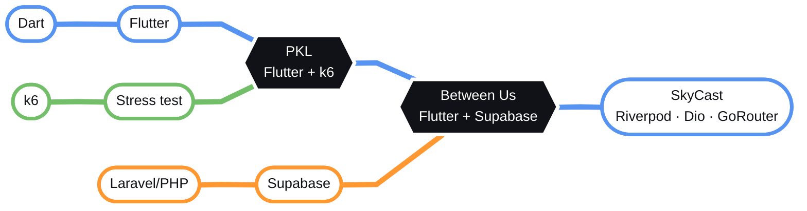

<div align="center">

# devboard / Revand Abdurrahman Khadafi

<sub>dashboard profil · mampir kapan pun, statusnya selalu nyala</sub>

<br>

<table>
<tr>
<td align="center"><sub>STATUS</sub><br><br><sub>siap nerima tugas baru</sub></td>
<td align="center"><sub>FOKUS</sub><br><br><sub>Flutter · Dart</sub></td>
<td align="center"><sub>STRESS TEST</sub><br><br><sub>lagi ramping naik</sub></td>
<td align="center"><sub>DULU</sub><br><br><sub>PHP · standby</sub></td>
</tr>
</table>

</div>

<br>

**halo, aku NAMA.**
lagi seru-serunya bikin aplikasi mobile pakai **Flutter dan Dart**, sambil belajar nge-stress test pakai **k6**. dulu sempat mampir ke Laravel/PHP, dan itu yang jadi pondasi backend-ku sampai sekarang.

### kurva belajar (VUs)

```text
 VUs
 ▲
 │                                         ╭───● sekarang
 │                                 ╭──────╯
 │                         ╭───────╯
 │               ╭─────────╯
 │ ───────────────╯   ← mulai PKL
 └──────────────────────────────────────────────────────▶ waktu
   Laravel/PHP    PKL · Flutter · Dart · k6
```

### skill status

| skill | status |
|:--|:--|
| Flutter |  |
| Dart |  |
| k6 |  |
| Laravel/PHP |  |

> [!WARNING]
> **k6** · masih belajar baca p(95) dan error rate

> [!TIP]
> **next** · bikin dan rilis lebih banyak project

### peta jalur




<sub>stasiun hitam adalah titik pertemuan antar jalur. stasiun nambah tiap ada project baru.</sub>

<details>
<summary>logs</summary>

```diff
+ INFO  Laravel/PHP sudah pernah dipakai, jadi pondasi backend
+ INFO  PKL: pindah haluan ke Flutter + Dart
- WARN  k6: masih belajar baca p(95) dan error rate
+ INFO  next: bikin dan rilis lebih banyak project
```

</details>

### ngobrol yuk

- email: [EMAILKAMU](mailto:EMAILKAMU)
- instagram: [@USERNAMEIG](https://instagram.com/USERNAMEIG)
- linkedin: [NAMA](https://linkedin.com/in/USERNAMELINKEDIN)

<sub>project terbaruku ada di pinned repositories di atas.</sub>
